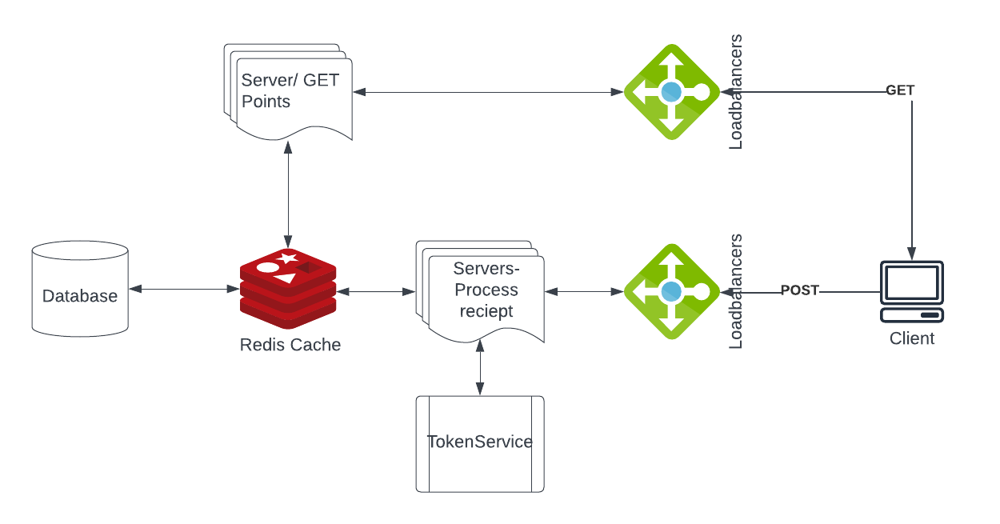

# 🧾 Receipt Processor API: Fetch Backend Challenge

> A Node.js and Express REST API that validates shopping receipts, scores them with a set of reward-point rules and returns the points by receipt ID. It's containerized with Docker and covered by 20 end-to-end API tests.


---

## Table of Contents

- [Overview](#overview)
- [Quick Start](#quick-start)
- [API Reference](#api-reference)
- [Points Rules](#points-rules)
- [Worked Example](#worked-example)
- [Validation](#validation)
- [Testing](#testing)
- [Project Structure](#project-structure)
- [Design Notes](#design-notes)
- [Scaling the Design](#scaling-the-design)
- [License](#license)

---

## Overview

This service is my solution to the [Fetch Rewards](https://fetch.com/) **Receipt Processor** backend challenge. It exposes two endpoints:

1. **`POST /receipts/process`** validates a receipt, calculates its points and returns a unique ID.
2. **`GET /receipts/{id}/points`** returns the points earned by that receipt.

Data is kept in memory, as the challenge specifies, so nothing persists after the server restarts.

---

## Quick Start

### Option 1: Docker (recommended)

```bash
git clone <your-repo-url> receipt-processor
cd receipt-processor

docker build -t node-fetch-backend .
docker run -d -p 5001:5001 --name receipt-processor node-fetch-backend
```

The API is now running at **http://localhost:5001**.

To stop and remove it:

```bash
docker stop receipt-processor && docker rm receipt-processor
```

### Option 2: Run locally

Requires Node.js 18 or later.

```bash
npm install
npm start          # or: npm run dev   (auto-reloads with nodemon)
```

The port defaults to `5001`. To change it, set the `PORT` environment variable or add it to a `.env` file.

---

## API Reference

### `POST /receipts/process`

Submits a receipt for processing.

**Request body**

| Field | Type | Format | Example |
|---|---|---|---|
| `retailer` | string | Name of the store; can't start with whitespace | `"Target"` |
| `purchaseDate` | string | `YYYY-MM-DD`, must be a real calendar date | `"2022-01-01"` |
| `purchaseTime` | string | 24-hour `HH:MM` (seconds optional) | `"13:01"` |
| `items` | array | One or more `{ shortDescription, price }` objects | see below |
| `items[].shortDescription` | string | Letters, digits, spaces, `_` and `-` only | `"Mountain Dew 12PK"` |
| `items[].price` | string | Exactly two decimal places | `"6.49"` |
| `total` | string | Exactly two decimal places | `"35.35"` |

**Example**

```bash
curl -X POST http://localhost:5001/receipts/process \
  -H "Content-Type: application/json" \
  -d '{
    "retailer": "Target",
    "purchaseDate": "2022-01-01",
    "purchaseTime": "13:01",
    "items": [
      { "shortDescription": "Mountain Dew 12PK", "price": "6.49" },
      { "shortDescription": "Emils Cheese Pizza", "price": "12.25" },
      { "shortDescription": "Knorr Creamy Chicken", "price": "1.26" },
      { "shortDescription": "Doritos Nacho Cheese", "price": "3.35" },
      { "shortDescription": "   Klarbrunn 12-PK 12 FL OZ  ", "price": "12.00" }
    ],
    "total": "35.35"
  }'
```

**Responses**

| Status | Body |
|---|---|
| `201 Created` | `{ "id": "7fb1377b-b223-49d9-a31a-5a02701dd310" }` |
| `400 Bad Request` | `{ "error": "<reason>" }` (see [Validation](#validation)) |

### `GET /receipts/{id}/points`

Returns the points awarded to a processed receipt.

```bash
curl http://localhost:5001/receipts/7fb1377b-b223-49d9-a31a-5a02701dd310/points
```

| Status | Body |
|---|---|
| `200 OK` | `{ "points": 28 }` |
| `404 Not Found` | `"No receipt found for that id"` |

---

## Points Rules

Each receipt's points are the sum of these rules. Each rule is its own function in `controller/processRecipt.js`.

| # | Rule | Points |
|---|---|---|
| 1 | Each alphanumeric character in the retailer name | +1 per character |
| 2 | Total is a round dollar amount with no cents | +50 |
| 3 | Total is a multiple of `0.25` | +25 |
| 4 | Every two items on the receipt | +5 per pair |
| 5 | Trimmed item description length is a multiple of 3 | + ⌈price × 0.2⌉ for that item |
| 6 | Day of the purchase date is odd | +6 |
| 7 | Purchase time is after 2:00 PM and before 4:00 PM | +10 |

---

## Worked Example

For the Target receipt above:

| Rule | Calculation | Points |
|---|---|---|
| Retailer name | `Target` has 6 alphanumeric characters | 6 |
| Round dollar | `35.35` isn't a whole dollar | 0 |
| Multiple of 0.25 | `35.35` isn't a multiple of 0.25 | 0 |
| Item pairs | 5 items make 2 pairs | 10 |
| Description length | `Emils Cheese Pizza` (18 chars): ⌈12.25 × 0.2⌉ = 3<br>`Klarbrunn 12-PK 12 FL OZ` (24 chars): ⌈12.00 × 0.2⌉ = 3 | 6 |
| Odd day | Day 1 is odd | 6 |
| 2–4 PM | 13:01 is outside the window | 0 |
| **Total** | | **28** |

---

## Validation

Receipts are checked in `controller/receiptValidator.js` before any points are calculated. An invalid receipt gets a `400` response with one of these messages:

| Error message | Cause |
|---|---|
| `All fields are required` | A top-level field is missing or empty |
| `Invalid retailer name` | Retailer name starts with whitespace |
| `Invalid total amount` | Total doesn't have exactly two decimal places (for example `9.999`) |
| `Invalid item description or price` | No items, a missing field, special characters in a description, or a price without exactly two decimals |
| `Invalid purchase date` | Wrong format (for example `2022/09/05`) or a date that doesn't exist (for example `2023-13-45`), with leap years handled |
| `Invalid purchase time` | Not 24-hour `HH:MM` (for example `12:30 PM`) |

---

## Testing

The test suite (`APIUnitTests.js`) has **20 end-to-end tests** written with **Mocha** and **Frisby**. They send real HTTP requests to the running server and check both the responses and the points calculations.

The suite covers:
- ✅ Correct points for the official example receipts (28 and 109 points)
- ✅ Each scoring rule: round totals, multiples of 0.25, odd days, the 2–4 PM window and description length
- ✅ Edge cases: single items, special characters in the retailer name, padded descriptions
- ❌ Rejection of empty fields, bad date and time formats, impossible dates, non-numeric prices, invalid totals and invalid descriptions

**To run the tests**, start the server (with Docker or `npm start`) and then, in another terminal, run:

```bash
npm test
```

---

## Project Structure

```
receipt-processor/
├── server.js                    # Express app setup (port 5001)
├── routes/
│   └── receiptRoute.js          # POST /process and GET /:id/points
├── controller/
│   ├── pointController.js       # Request handlers and in-memory store
│   ├── processRecipt.js         # Points rules, one function per rule
│   └── receiptValidator.js      # Field validation
├── middleware/
│   └── errorHandler.js          # Error-handling middleware
├── constants.js                 # HTTP status codes
├── APIUnitTests.js              # 20 Mocha + Frisby API tests
├── SD_fetch_rewards.png         # Scaled-up system design diagram
├── Dockerfile
└── package.json
```

---

## Design Notes

- **Layered structure.** Routes, controllers, validation and points rules live in separate files, so each rule can be tested on its own.
- **Validate first, then calculate.** Bad input is rejected with a clear message before any scoring happens.
- **UUID receipt IDs.** IDs are generated with `uuid` v4, with a collision check before storing.
- **Exact decimal checks.** Totals and prices are validated as strings with exactly two decimals, so floating-point rounding can't affect validation.
- **In-memory store.** A plain object maps receipt IDs to points. Lookups are fast, but data is lost on restart, which the challenge allows.

---

## Scaling the Design

For a production version I sketched this architecture:



- **Separate services for reads and writes.** POST (process) and GET (points) traffic each go through their own load balancer and server pool, so each can scale independently.
- **Redis cache** in front of a persistent **database** for fast points lookups.
- **Token service** to issue unique receipt IDs across many server instances.

---

## License

This project is licensed under the [MIT License](LICENSE).
